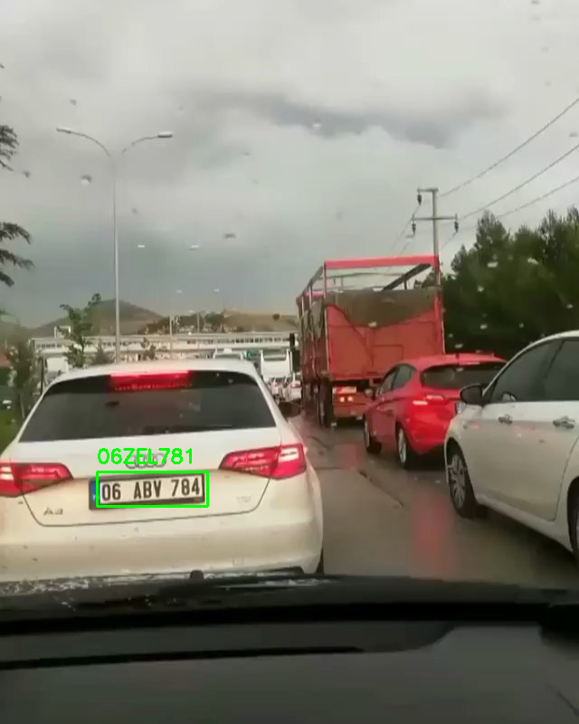
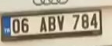
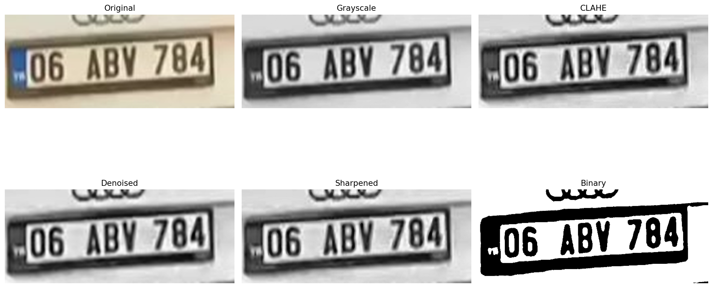

# Automatic License Plate Recognition (ALPR)

[Open the notebook in Google Colab](https://colab.research.google.com/github/gizemnurbektas/opencv-license-plate-recognition/blob/main/automatic_license_plate_recognition.ipynb)

A Google Colab demonstration of license plate text detection and OCR using Python, OpenCV, and EasyOCR. The notebook uses one vehicle image from the Turkish License Plate 250 Dataset.

## Results

**Input vehicle image**

**Initial OCR output:** the plate region was found, but the text was misread.

**Detected and enlarged plate crop**

**Preprocessing comparison**

**Final displayed reading**

## What went wrong and how it was corrected

1. On the full vehicle image, EasyOCR first read the plate as **06ZEL781** with confidence **0.148**. The plate area was detected, but the characters were wrong. The dataset filename gives **06 ABV784** as the transcription for this sample.
2. Cropping the detected region, enlarging it 3×, and converting it to grayscale still produced conflicting text (3, 06ZBV7808).
3. The notebook then enlarged the crop 4× and compared the original, grayscale, CLAHE contrast enhancement, bilateral denoising, sharpening, and Otsu thresholding. OCR still confused several letters and digits.
4. Combining the original-image OCR fragments left-to-right produced 006ABV784. A strict format check rejected it because the extra leading zero made the province code appear to have three digits.
5. The notebook's clean_plate() normalization removes non-alphanumeric characters and redundant leading zeros. This yields **06ABV784**, which matches this sample's filename transcription and is displayed on the image.

The format check is only a plausibility filter, not proof of a correct reading: other preprocessing variants also produced plausible-looking but incorrect candidates. This is a one-image demonstration, not a dataset-wide accuracy evaluation.

## Notebook workflow

- Install EasyOCR and load the image in Colab.
- Run OCR on the vehicle image and draw the detected text region.
- Crop and enlarge the most confident detected region.
- Compare OCR across several image preprocessing variants.
- Normalize and format-check candidate text, then annotate the final display.

## Run it

Open the notebook using the Colab link above and run its cells. When prompted, upload a vehicle image. EasyOCR may use a GPU if Colab provides one; CPU execution is also possible but can be slower.

## Dataset and attribution

This example uses one image from the [Turkish License Plate 250 Dataset](https://doi.org/10.5281/zenodo.23369685), contributed by Ahmet Selman Bozkır. The dataset record describes 250 real-world Turkish vehicle images, YOLO-format plate boxes, and filename transcriptions. The record lists **CC BY 4.0** and also notes non-commercial academic research use. Review the [dataset record](https://datasetcatalog.nlm.nih.gov/dataset?q=0003374053) and its terms before reusing the data. Only the single example image and this notebook's result images are included here; the full dataset is not redistributed.

License plates can be personal data. Do not use this example to identify vehicle owners or link plate numbers to other records.

## Limitations

- Only one image is demonstrated; no precision, recall, or dataset-wide accuracy is reported.
- OCR quality depends on image clarity, lighting, angle, and plate size.
- A plate-shaped string can still contain OCR mistakes even when it passes a regular expression.
- The notebook's current format expression allows 2–5 digits after the letters; the dataset description specifies 2–4 for its plates, so adjust validation if using this dataset systematically.
- EasyOCR uses its English model with an alphanumeric character allowlist; this does not guarantee reliable recognition of every plate style.

## License

The repository's MIT License covers the project code. Dataset images and other third-party material remain subject to their original license and terms; see the attribution above.
